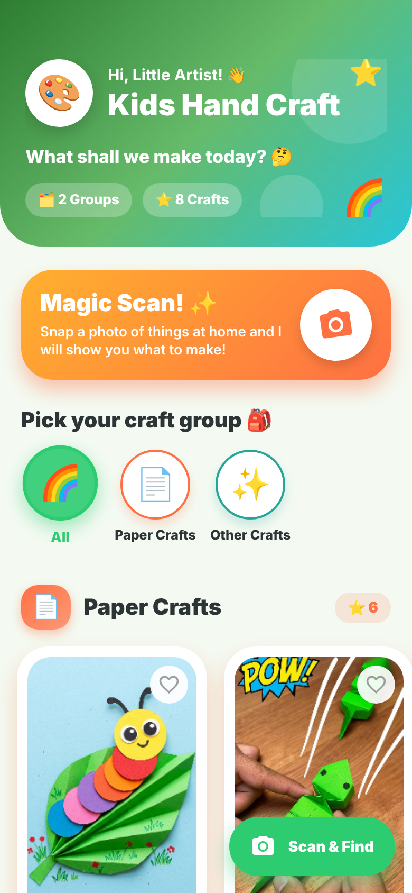
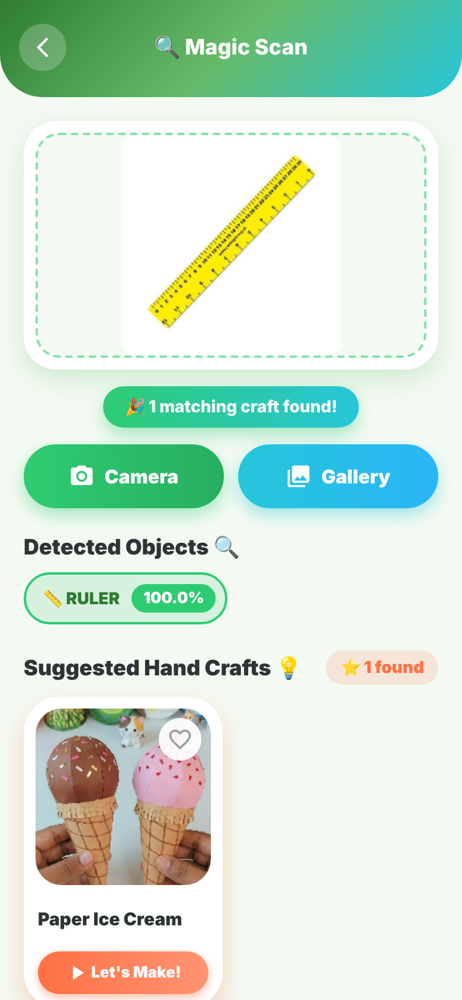
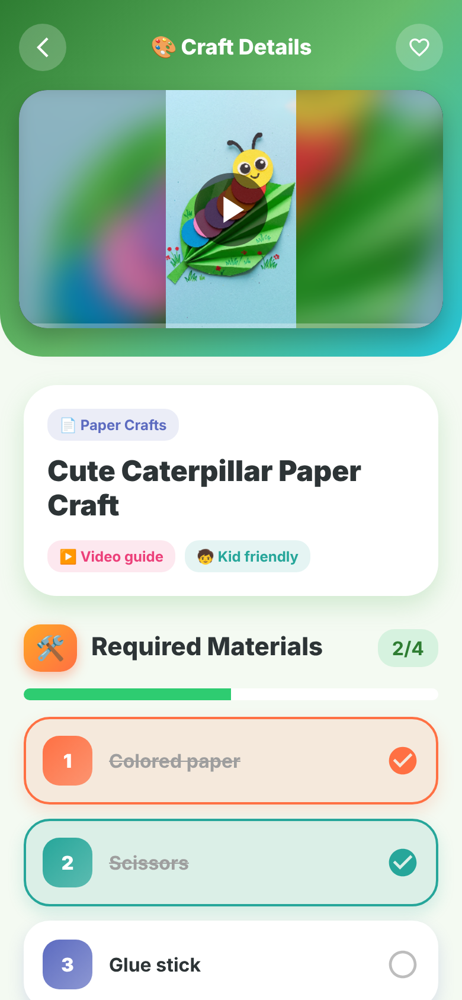
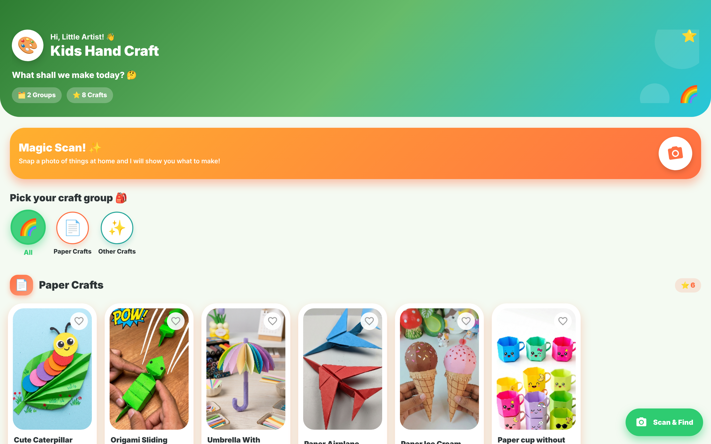
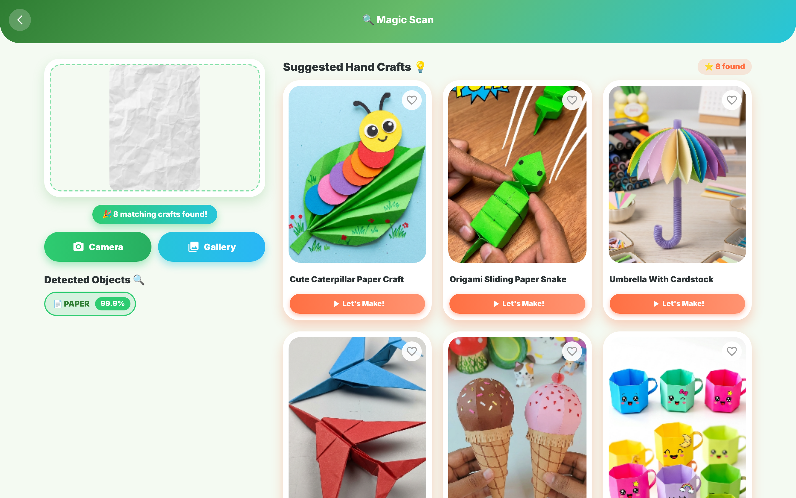

# 🎨 Kids Hand Craft App (AI-Powered Craft Recommender)

An interactive Flutter application powered by **Machine Learning (MobileNetV2)** and **Firebase Firestore** designed to help kids and parents discover creative hand crafts using everyday stationery and household items!

Users can snap a photo with their camera or upload an image from their gallery. The built-in AI model detects the items in the image (e.g., *paper, pencil, straw, glue, cardboard, etc.*) and immediately suggests fun, kid-friendly hand craft projects along with step-by-step video tutorials.

---

## ✨ Key Features

* **🤖 AI Object Classification (MobileNetV2 + TFLite):** Detects up to **12 different stationery and craft materials** in real-time with confidence percentages.
* **🔍 Multi-Material Detection & Smart Suggestions:** Identifies single or multiple materials in an image and queries Firebase Firestore to recommend matching hand crafts.
* **🎥 Interactive Video Guides:** Embedded YouTube video player with a smooth floating mini-player experience while scrolling through instructions.
* **✅ Interactive Material Checklist:** Kids can check off the required materials they have gathered with a real-time progress bar.
* **📱 Cross-Platform Support:** Works seamlessly on both **Mobile (Android/iOS)** and **Web**.

---

## 🏷️ Supported Craft Materials (12 Classes)

The custom-trained MobileNetV2 model recognizes the following 12 items:
1. `Cardboard`
2. `Ruler`
3. `Glue`
4. `Paper`
5. `Paper Cup`
6. `Pen`
7. `Pencil`
8. `Plastic`
9. `Scissor`
10. `Straw`
11. `Wool`
12. `Yarn Cone`

---

## 📸 Screenshots

> **Note:** Replace the image paths below with the actual paths to your screenshots inside your repository (e.g., `screenshots/mobile_home.png`).

### 📱 Mobile View
| Splash & Home Screen | AI Scan & Suggest | Craft Details & Video Guide |
| :---: | :---: | :---: |
|  |  |  |

### 💻 Web View
| Web Dashboard / Home View | Web AI Detection & Suggestions |
| :---: | :---: |
|  |  |

---

## 🛠️ Tech Stack

* **Frontend:** Flutter (Dart)
* **Machine Learning:** TensorFlow / Keras (MobileNetV2), TensorFlow Lite (`flutter_litert`)
* **Backend & Database:** Firebase Cloud Firestore
* **Media & Plugins:** `image_picker`, `youtube_player_flutter`, `image`

---

## 🚀 Getting Started

### Prerequisites
* Flutter SDK installed (`>=3.0.0`)
* A configured Firebase project with Cloud Firestore enabled.

### Installation

1. **Clone the repository:**
   ```bash
   git clone https://github.com/your-username/kids-hand-craft-app.git
   cd kids-hand-craft-app
   ```

2. **Install dependencies:**
   ```bash
   flutter pub get
   ```

3. **Firebase Setup:**
   * Ensure your `firebase_options.dart` is properly configured.
   * Create a Firestore collection named `craft` with documents containing fields:
     * `title` (String)
     * `category` (String)
     * `description` (String)
     * `imagePath` (String)
     * `videoUrl` (String)
     * `materials` (Array of lowercase strings, e.g., `["paper", "glue", "scissor"]`)

4. **Model Assets:**
   * Place `mobilenet_paper_model.tflite` and `labels.txt` inside `assets/model/`.

5. **Run the application:**
   * For Mobile:
     ```bash
     flutter run
     ```
   * For Web:
     ```bash
     flutter run -d chrome
     ```

---

## 🤝 Contributing

Contributions, issues, and feature requests are welcome! Feel free to check the [issues page](https://github.com/your-username/kids-hand-craft-app/issues).

## 📄 License

This project is licensed under the MIT License.
